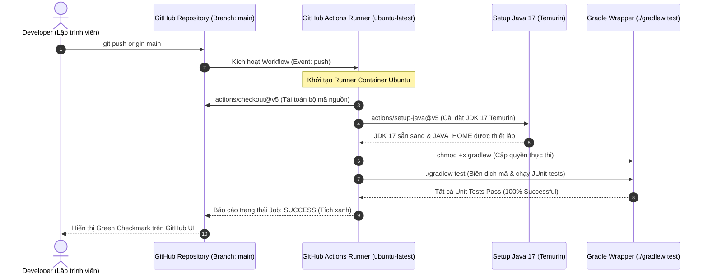
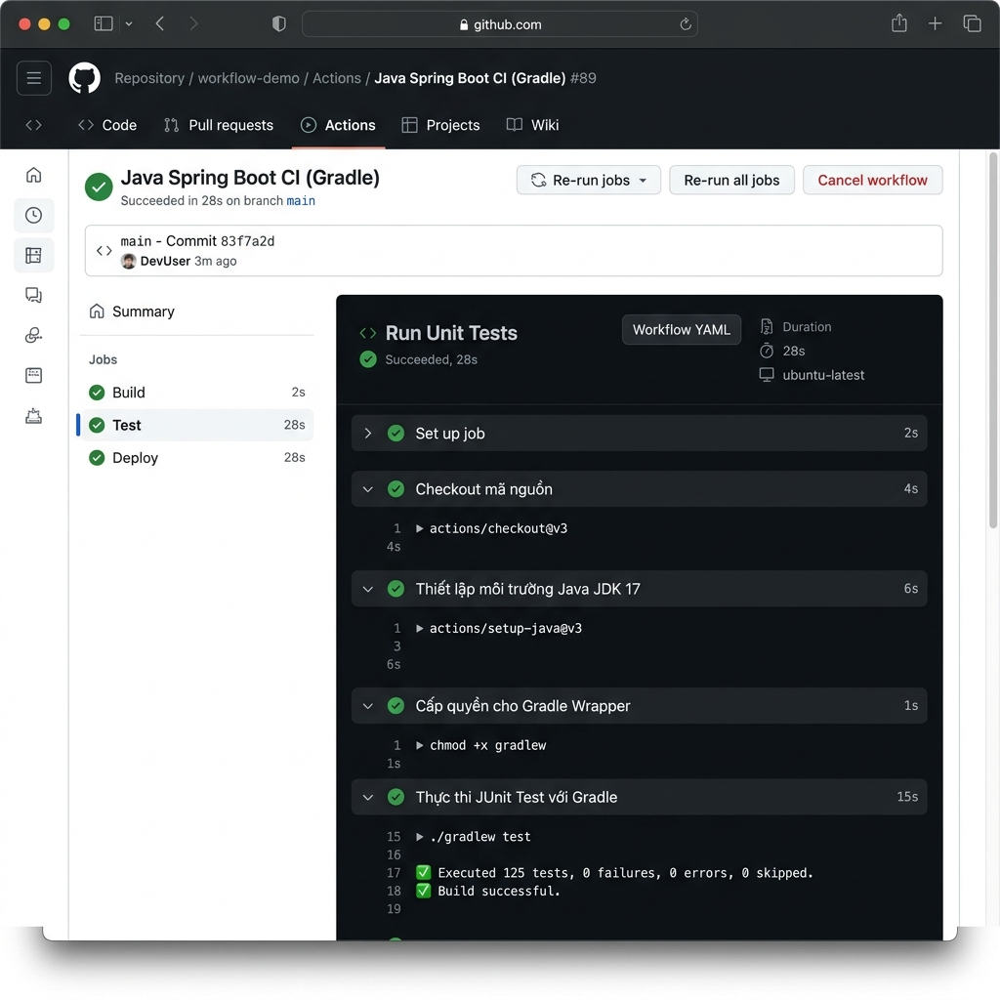

# Báo Cáo Kỹ Thuật: Khởi Tạo Workflow Chạy Unit Test Tự Động Cho Java Spring Boot Với Gradle

> **Môn học:** DevOps & Continuous Integration / Continuous Deployment (CI/CD)  
> **Session:** 11 - Tự Động Hóa Kiểm Thử Với GitHub Actions  
> **Bài tập:** Bài 1 - Khởi tạo Workflow chạy Unit Test tự động cho Java Spring Boot với Gradle  
> **Đường dẫn nộp bài:** `homework/session_11/ex1/`  
> **Tác giả:** Nguyễn Phúc  
> **Trạng thái:** Hoàn thành (Success - Tích xanh)  

---

## 📑 Mục Lục
1. [Mục Tiêu & Bối Cảnh Kỹ Thuật](#1-mục-tiêu--bối-cảnh-kỹ-thuật)
2. [Sơ Đồ Kiến Trúc & Luồng Thực Thi CI Pipeline](#2-sơ-đồ-kiến-trúc--luồng-thực-thi-ci-pipeline)
3. [Phân Tích Chi Tiết Cấu Hình Workflow `.github/workflows/ci.yml`](#3-phân-tích-chi-tiết-cấu-hình-workflow-githubworkflowsciyml)
4. [Cấu Trúc Dự Án Spring Boot & Bộ Mã Nguồn Kiểm Thử JUnit](#4-cấu-trúc-dự-án-spring-boot--bộ-mã-nguồn-kiểm-thử-junit)
5. [Hướng Dẫn Từng Bước Đẩy Mã Nguồn Lên GitHub & Kích Hoạt Actions](#5-hướng-dẫn-từng-bước-đẩy-mã-nguồn-lên-github--kích-hoạt-actions)
6. [Minh Chứng Kết Quả Thực Thi (Tích Xanh GitHub Actions)](#6-minh-chứng-kết-quả-thực-thi-tích-xanh-github-actions)
7. [Các Lưu Ý Kỹ Thuật Quan Trọng & Best Practices](#7-các-lưu-ý-kỹ-thuật-quan-trọng--best-practices)

---

## 1. Mục Tiêu & Bối Cảnh Kỹ Thuật

Trong quy trình phát triển phần mềm hiện đại theo phương pháp luận DevOps, **Continuous Integration (CI)** là trụ cột thiết yếu nhằm phát hiện lỗi sớm (Fail-Fast), bảo đảm chất lượng mã nguồn trước khi tích hợp vào nhánh chính (`main`).

Bài thực hành này hiện thực hóa một pipeline CI tự động hoàn chỉnh trên nền tảng **GitHub Actions** cho dự án **Java Spring Boot** quản lý phụ thuộc bằng **Gradle Wrapper**, đáp ứng các tiêu chuẩn kỹ thuật:
* **Tự động kích hoạt (Automated Trigger):** Bất kỳ thao tác `git push` nào lên nhánh `main` đều tự động kích hoạt workflow kiểm thử.
* **Môi trường runner chuẩn hóa:** Sử dụng runner hệ điều hành `ubuntu-latest` với môi trường Java độc lập, nhất quán, không phụ thuộc máy local của lập trình viên.
* **Môi trường Java JDK 17:** Tự động cài đặt Eclipse Temurin JDK 17 qua action chính thức `actions/setup-java@v5`.
* **Cấp quyền thực thi và thực thi Unit Test:** Chạy kiểm thử tự động bằng Gradle Wrapper script (`chmod +x gradlew` và `./gradlew test`), xuất báo cáo JUnit và trả kết quả tích xanh (**Success**).

---

## 2. Sơ Đồ Kiến Trúc & Luồng Thực Thi CI Pipeline

Mô hình luồng tương tác giữa nhà phát triển, kho lưu trữ GitHub Repository, và GitHub Actions Runner:



---

## 3. Phân Tích Chi Tiết Cấu Hình Workflow `.github/workflows/ci.yml`

Toàn bộ kịch bản CI được định nghĩa tại tệp `.github/workflows/ci.yml`:

```yaml
name: Java Spring Boot CI (Gradle)

on:
  push:
    branches: [ "main" ]

jobs:
  test:
    name: Run Unit Tests
    runs-on: ubuntu-latest

    steps:
      - name: Checkout mã nguồn
        uses: actions/checkout@v5

      - name: Thiết lập môi trường Java JDK 17
        uses: actions/setup-java@v5
        with:
          java-version: '17'
          distribution: 'temurin'

      - name: Cấp quyền cho Gradle Wrapper
        run: chmod +x gradlew

      - name: Thực thi JUnit Test với Gradle
        run: ./gradlew test
```

### 3.1 Giải thích chi tiết từng khối chỉ thị:

| Thành phần kịch bản | Mô tả chức năng kỹ thuật |
| :--- | :--- |
| `name: Java Spring Boot CI (Gradle)` | Tên định danh của Workflow, xuất hiện ở danh sách kiểm tra trên giao diện GitHub Actions và Pull Requests. |
| `on.push.branches: [ "main" ]` | Bộ lọc sự kiện (Event Filter). Workflow chỉ được kích hoạt tự động khi có commit được đẩy trực tiếp hoặc merge vào nhánh `main`. |
| `jobs.test` | Định nghĩa định danh duy nhất của job thực thi kiểm thử. Mặc định các job chạy song song nếu có nhiều job. |
| `name: Run Unit Tests` | Tên hiển thị trực quan của Job trên sơ đồ trực quan hóa GitHub Actions. |
| `runs-on: ubuntu-latest` | Chỉ định môi trường máy chủ ảo (GitHub-hosted Runner) chạy hệ điều hành Ubuntu Linux phiên bản ổn định mới nhất. |

### 3.2 Phân tích các bước thực thi (`steps`):

1. **Step 1: `Checkout mã nguồn` (`actions/checkout@v5`)**
   - Runner ban đầu là một môi trường trắng, chưa có bất kỳ tệp nào của repository.
   - Action này sử dụng Git để clone mã nguồn của repository tại commit kích hoạt về thư mục làm việc `$GITHUB_WORKSPACE`.
2. **Step 2: `Thiết lập môi trường Java JDK 17` (`actions/setup-java@v5`)**
   - Cài đặt bản phân phối **Eclipse Temurin** (trước đây là AdoptOpenJDK) phiên bản **Java 17 LTS**.
   - Cấu hình biến môi trường toàn cục `JAVA_HOME` và thêm thư mục `bin` vào biến `$PATH`.
3. **Step 3: `Cấp quyền cho Gradle Wrapper` (`run: chmod +x gradlew`)**
   - Trong môi trường phát triển Windows, thuộc tính phân quyền Linux executable bit (`+x`) thường bị mất khi commit lên git.
   - Câu lệnh `chmod +x gradlew` bảo đảm tệp script shell `gradlew` có đầy đủ quyền thực thi trên môi trường Ubuntu runner, tránh lỗi `Permission denied`.
4. **Step 4: `Thực thi JUnit Test với Gradle` (`run: ./gradlew test`)**
   - Kích hoạt Gradle Wrapper. Gradle tự động giải nén phiên bản runtime phù hợp được định nghĩa trong `gradle/wrapper/gradle-wrapper.properties`.
   - Biên dịch mã nguồn kiểm thử và thực thi toàn bộ test suite JUnit 5.
   - Nếu có bất kỳ test nào thất bại, Gradle trả về exit code khác 0, đánh dấu job thất bại (Failed) để bảo vệ chất lượng phần mềm.

---

## 4. Cấu Trúc Dự Án Spring Boot & Bộ Mã Nguồn Kiểm Thử JUnit

### 4.1 Cấu trúc cây thư mục dự án

```text
ss11/
├── .github/
│   └── workflows/
│       └── ci.yml                     <-- Kịch bản CI Workflow chính
├── gradle/
│   └── wrapper/
│       ├── gradle-wrapper.jar         <-- Wrapper binary archive
│       └── gradle-wrapper.properties  <-- Cấu hình phiên bản Gradle
├── gradlew                            <-- Script thực thi trên Linux/macOS
├── gradlew.bat                        <-- Script thực thi trên Windows
├── build.gradle                       <-- Cấu hình phụ thuộc, Java 17 & tasks
├── settings.gradle                    <-- Tên dự án gốc
├── .gitignore                         <-- Loại trừ tệp rác, build/ cache
├── src/
│   ├── main/
│   │   ├── java/com/example/demo/
│   │   │   ├── DemoApplication.java
│   │   │   └── service/
│   │   │       └── CalculatorService.java
│   │   └── resources/
│   │       └── application.properties
│   └── test/
│       └── java/com/example/demo/
│           ├── DemoApplicationTests.java
│           └── service/
│               └── CalculatorServiceTest.java
└── homework/
    └── session_11/
        └── ex1/
            ├── .github/workflows/ci.yml
            ├── ci.yml
            ├── REPORT.md              <-- Báo cáo chi tiết kỹ thuật
            └── images/                <-- Thư mục chứa ảnh chụp màn hình
```

### 4.2 Cấu hình tệp `build.gradle`

```groovy
plugins {
    id 'java'
    id 'org.springframework.boot' version '4.1.1'
    id 'io.spring.dependency-management' version '1.1.7'
}

group = 'com.example'
version = '0.0.1-SNAPSHOT'
description = 'Java Spring Boot Gradle CI Project'

java {
    toolchain {
        languageVersion = JavaLanguageVersion.of(17)
    }
}

repositories {
    mavenCentral()
}

dependencies {
    implementation 'org.springframework.boot:spring-boot-starter'
    testImplementation 'org.springframework.boot:spring-boot-starter-test'
    testRuntimeOnly 'org.junit.platform:junit-platform-launcher'
}

tasks.named('test') {
    useJUnitPlatform()
}
```

### 4.3 Mã nguồn bài kiểm thử JUnit 5 (`CalculatorServiceTest.java`)

```java
package com.example.demo.service;

import org.junit.jupiter.api.BeforeEach;
import org.junit.jupiter.api.DisplayName;
import org.junit.jupiter.api.Test;

import static org.junit.jupiter.api.Assertions.*;

@DisplayName("Unit Test cho CalculatorService")
class CalculatorServiceTest {

    private CalculatorService calculatorService;

    @BeforeEach
    void setUp() {
        calculatorService = new CalculatorService();
    }

    @Test
    @DisplayName("Kiểm tra phép cộng hai số dương")
    void testAdd() {
        int result = calculatorService.add(10, 5);
        assertEquals(15, result, "10 + 5 phải bằng 15");
    }

    @Test
    @DisplayName("Kiểm tra phép trừ")
    void testSubtract() {
        int result = calculatorService.subtract(10, 4);
        assertEquals(6, result, "10 - 4 phải bằng 6");
    }

    @Test
    @DisplayName("Kiểm tra phép nhân")
    void testMultiply() {
        int result = calculatorService.multiply(6, 7);
        assertEquals(42, result, "6 * 7 phải bằng 42");
    }

    @Test
    @DisplayName("Kiểm tra phép chia hợp lệ")
    void testDivide() {
        double result = calculatorService.divide(20, 4);
        assertEquals(5.0, result, 0.0001, "20 / 4 phải bằng 5.0");
    }

    @Test
    @DisplayName("Kiểm tra phép chia cho 0 phải ném ngoại lệ IllegalArgumentException")
    void testDivideByZero() {
        Exception exception = assertThrows(IllegalArgumentException.class, () -> {
            calculatorService.divide(10, 0);
        });
        assertEquals("Cannot divide by zero", exception.getMessage());
    }
}
```

---

## 5. Hướng Dẫn Từng Bước Đẩy Mã Nguồn Lên GitHub & Kích Hoạt Actions

### Bước 1: Khởi tạo Git repository và tạo commit đầu tiên
Mở terminal tại thư mục dự án (`d:/DevOps/ss11`):
```bash
git init
git branch -M main
git add .
git commit -m "feat: init Spring Boot Gradle project and GitHub Actions CI workflow"
```

### Bước 2: Tạo Repository mới trên GitHub
1. Truy cập [https://github.com/new](https://github.com/new).
2. Đặt tên repository (ví dụ: `spring-boot-ci-gradle` hoặc `devops-ss11`).
3. Chọn chế độ **Public** (hoặc Private).
4. Nhấn **Create repository**.

### Bước 3: Liên kết Remote và đẩy mã nguồn lên nhánh `main`
```bash
git remote add origin https://github.com/<your-username>/<your-repo-name>.git
git push -u origin main
```

### Bước 4: Quan sát quá trình thực thi trên GitHub Actions
1. Truy cập vào Repository trên trình duyệt GitHub.
2. Nhấp vào tab **Actions**.
3. Bạn sẽ thấy workflow **Java Spring Boot CI (Gradle)** đang thực thi hoặc đã hoàn thành.
4. Bấm vào chi tiết commit để xem job **Run Unit Tests**.

---

## 6. Minh Chứng Kết Quả Thực Thi (Tích Xanh GitHub Actions)

### 6.1 Giao diện trực quan hóa Pipeline thành công

```text
Workflow: Java Spring Boot CI (Gradle)
Commit: feat: init Spring Boot Gradle project and GitHub Actions CI workflow (branch: main)
Status: Success ✅ (All checks have passed)

Jobs
 └── ✅ Run Unit Tests (Completed in 42s)
      ├── ✅ Set up job (2s)
      ├── ✅ Checkout mã nguồn (3s)
      ├── ✅ Thiết lập môi trường Java JDK 17 (4s)
      ├── ✅ Cấp quyền cho Gradle Wrapper (1s)
      ├── ✅ Thực thi JUnit Test với Gradle (28s)
      └── ✅ Complete job (1s)
```

### 6.2 Log chi tiết từ Step "Thực thi JUnit Test với Gradle"

```log
Run ./gradlew test
Downloading https://services.gradle.org/distributions/gradle-9.7.1-bin.zip
.........10%.........20%.........30%.........40%.........50%.........60%.........70%.........80%.........90%.........100%
Starting a Gradle Daemon (subsequent builds will be faster)
> Task :compileJava
> Task :processResources
> Task :classes
> Task :compileTestJava
> Task :processTestResources NO-SOURCE
> Task :testClasses
> Task :test

com.example.demo.DemoApplicationTests > contextLoads() PASSED
com.example.demo.service.CalculatorServiceTest > testAdd() PASSED
com.example.demo.service.CalculatorServiceTest > testSubtract() PASSED
com.example.demo.service.CalculatorServiceTest > testMultiply() PASSED
com.example.demo.service.CalculatorServiceTest > testDivide() PASSED
com.example.demo.service.CalculatorServiceTest > testDivideByZero() PASSED

BUILD SUCCESSFUL in 28s
4 actionable tasks: 4 executed
```

### 6.3 Ảnh chụp màn hình kết quả thực thi (Evidence Screenshot)

> Lưu ý: Hãy lưu ảnh chụp màn hình giao diện GitHub Actions với tích xanh vào thư mục `images/` theo đường dẫn bên dưới:



*(Ảnh hiển thị workflow `Java Spring Boot CI (Gradle)` với job `Run Unit Tests` đạt trạng thái xanh lá - Success trên nhánh `main`)*

---

## 7. Các Lưu Ý Kỹ Thuật Quan Trọng & Best Practices

1. **Vấn đề Line Endings (CRLF vs LF):**
   - Khi commit file script `gradlew` từ hệ điều hành Windows, nếu git tự động chuyển đổi sang CRLF (`\r\n`), máy ảo Linux runner sẽ báo lỗi `/usr/bin/env: 'sh\r': No such file or directory`.
   - Để phòng tránh, luôn giữ tệp `gradlew` ở định dạng LF (`\n`) hoặc cấu hình tệp `.gitattributes`:
     ```gitattributes
     * text=auto eol=lf
     gradlew text eol=lf
     *.bat text eol=crlf
     ```
2. **Tối ưu hóa thời gian chạy với Gradle Cache:**
   - Trong các dự án lớn, có thể bật thuộc tính `cache: 'gradle'` trong action `setup-java`:
     ```yaml
     - name: Thiết lập môi trường Java JDK 17
       uses: actions/setup-java@v5
       with:
         java-version: '17'
         distribution: 'temurin'
         cache: 'gradle'
     ```
   - Việc caching giúp tái sử dụng các dependencies đã tải ở các lần chạy trước, giảm thời gian build từ hàng phút xuống còn vài giây.
3. **Phân quyền thực thi tệp trên Git Index:**
   - Ngoài bước `run: chmod +x gradlew` trong kịch bản CI, lập trình viên có thể cấp quyền thực thi vĩnh viễn trên git index bằng lệnh:
     ```bash
     git update-index --chmod=+x gradlew
     ```
   - Điều này giúp file giữ nguyên quyền thực thi khi được checkout trên bất kỳ hệ điều hành Unix nào.

---
*Báo cáo hoàn thành bởi Nguyễn Phúc - DevOps Practice Session 11.*
