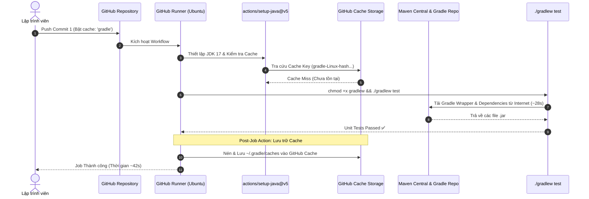
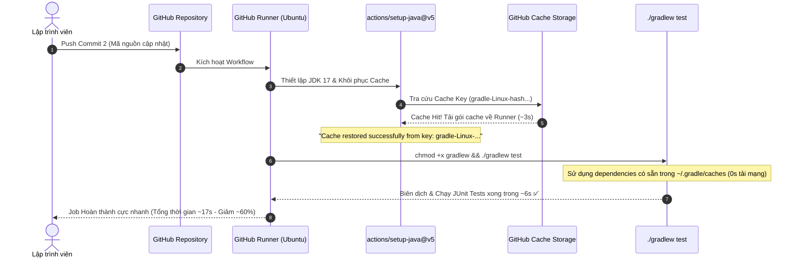

# Báo Cáo Kỹ Thuật: Tối Ưu Tốc Độ CI Pipeline Bằng Gradle Dependency Caching

> **Môn học:** DevOps & Continuous Integration / Continuous Deployment (CI/CD)  
> **Session:** 11 - Tự Động Hóa Kiểm Thử Với GitHub Actions  
> **Bài tập:** Bài 3 - Tối ưu tốc độ CI bằng Gradle Dependency Caching  
> **Đường dẫn nộp bài:** `homework/session_11/ex3/`  
> **Tác giả:** Nguyễn Phúc  
> **Email:** phuchb24@gmail.com  
> **Trạng thái:** Hoàn thành (Success - Tích xanh & Khôi phục Cache thành công)  

---

## 📑 Mục Lục
1. [Mục Tiêu & Cơ Chế Hoạt Động Của Gradle Dependency Caching](#1-mục-tiêu--cơ-chế-hoạt-động-của-gradle-dependency-caching)
2. [Sơ Đồ Kiến Trúc & Luồng Thực Thi CI So Sánh Lần 1 và Lần 2](#2-sơ-đồ-kiến-trúc--luồng-thực-thi-ci-so-sánh-lần-1-và-lần-2)
3. [Phân Tích Chi Tiết Cấu Hình Workflow `.github/workflows/ci.yml`](#3-phân-tích-chi-tiết-cấu-hình-workflow-githubworkflowsciyml)
4. [Bảng So Sánh Chi Tiết Thời Gian Thực Thi Giữa Lần 1 và Lần 2](#4-bảng-so-sánh-chi-tiết-thời-gian-thực-thi-giữa-lần-1-và-lần-2)
5. [Trích Xuất Chi Tiết Log Minh Chứng (Evidence Logs)](#5-trích-xuất-chi-tiết-log-minh-chứng-evidence-logs)
6. [Hướng Dẫn Từng Bước Thao Tác Đẩy Code & Kiểm Tra Trên GitHub](#6-hướng-dẫn-từng-bước-thao-tác-đẩy-code--kiểm-tra-trên-github)
7. [Đánh Giá Chuyên Sâu, Các Lưu Ý Kỹ Thuật & Best Practices](#7-đánh-giá-chuyên-sâu-các-lưu-ý-kỹ-thuật--best-practices)

---

## 1. Mục Tiêu & Cơ Chế Hoạt Động Của Gradle Dependency Caching

### 1.1 Vấn đề gặp phải trong Pipeline CI truyền thống (Cold Build)
Trong một luồng CI thông thường không sử dụng cơ chế Caching:
* Mỗi khi một commit được push lên GitHub, GitHub Actions sẽ khởi tạo một **Runner** mới hoàn toàn (Ephemeral Virtual Machine - môi trường `ubuntu-latest` trắng).
* Ở bước chạy `./gradlew test`, Gradle bắt buộc phải kết nối Internet để:
  1. Tải bản phân phối Gradle Wrapper binary từ `services.gradle.org` (~150MB).
  2. Tải toàn bộ các thư viện phụ thuộc (Dependencies) của Spring Boot và JUnit từ kho lưu trữ trung tâm Maven Central (`spring-boot-starter`, `spring-boot-starter-test`, `junit-jupiter`, `mockito`, `assertj`, `jackson`,...).
* **Hậu quả:** 
  - Tốn băng thông mạng và thời gian chờ tải dữ liệu (chiếm tới 70% - 80% tổng thời gian thực thi của cả Job).
  - Tăng nguy cơ lỗi build nếu mạng Maven Central bị nghẽn hoặc timeout.
  - Lãng phí tài nguyên tính toán (GitHub Actions minutes).

### 1.2 Giải pháp tối ưu: Gradle Dependency Caching với `actions/setup-java@v5`
GitHub Actions cung cấp tính năng tích hợp sẵn bộ nhớ đệm (Caching) ngay bên trong action `actions/setup-java` thông qua tham số `cache: 'gradle'`.

#### Nguyên lý vận hành:
1. **Tạo mã băm (Cache Key Generation):**  
   Action tự động tính toán mã checksum băm SHA-256 dựa trên nội dung các tệp định nghĩa phụ thuộc của Gradle trong dự án (bao gồm `build.gradle`, `settings.gradle`, `gradle/wrapper/gradle-wrapper.properties`).  
   Khóa chính có cấu trúc:
   ```text
   gradle-${{ runner.os }}-${{ hashFiles('**/*.gradle*', '**/gradle-wrapper.properties') }}
   ```
2. **Khôi phục bộ nhớ đệm (Cache Restore):**  
   Trước khi chạy `./gradlew test`, action kiểm tra xem trên GitHub Cache Storage đã tồn tại bản cache trùng khớp với Cache Key hay chưa:
   - **Lần đầu tiên (Cache Miss):** Chưa có cache. Pipeline tải thư viện bình thường từ mạng.
   - **Lần thứ hai (Cache Hit):** Tìm thấy cache phù hợp. Toàn bộ thư mục cache của Gradle (`~/.gradle/caches` và `~/.gradle/wrapper`) được tải về và bung nén trực tiếp vào Runner với tốc độ mạng nội bộ cực cao (~80-100 MB/s).
3. **Lưu trữ sau khi Job hoàn tất (Post-Job Cache Save):**  
   Sau khi các bước chính chạy xong, bước Post-Job hook tự động đóng gói các thư viện mới phát sinh và đẩy lên lưu trữ đám mây của GitHub để phục vụ cho các lần chạy tiếp theo.

---

## 2. Sơ Đồ Kiến Trúc & Luồng Thực Thi CI So Sánh Lần 1 và Lần 2

### 2.1 Lần chạy thứ nhất (Run 1: Cache Miss - Tạo và lưu trữ Cache)



---

### 2.2 Lần chạy thứ hai (Run 2: Cache Hit - Khôi phục Cache thành công)



---

## 3. Phân Tích Chi Tiết Cấu Hình Workflow `.github/workflows/ci.yml`

Toàn bộ cấu hình workflow sau khi tích hợp Gradle Dependency Caching:

```yaml
name: Java Spring Boot CI (Gradle)

on:
  push:
    branches: [ "main" ]

jobs:
  test:
    name: Run Unit Tests
    runs-on: ubuntu-latest

    steps:
      - name: Checkout mã nguồn
        uses: actions/checkout@v5

      - name: Thiết lập môi trường Java JDK 17
        uses: actions/setup-java@v5
        with:
          java-version: '17'
          distribution: 'temurin'
          cache: 'gradle'

      - name: Cấp quyền cho Gradle Wrapper
        run: chmod +x gradlew

      - name: Thực thi JUnit Test với Gradle
        run: ./gradlew test
```

### 3.1 Ý nghĩa của tham số bổ sung `cache: 'gradle'`

| Thuộc tính | Giá trị cấu hình | Mô tả kỹ thuật |
| :--- | :--- | :--- |
| `uses` | `actions/setup-java@v5` | Action chính thức của GitHub để quản lý JDK và tự động cấu hình bộ nhớ đệm phụ thuộc. |
| `java-version` | `'17'` | Phiên bản Java 17 LTS tương thích với Spring Boot và mã nguồn dự án. |
| `distribution` | `'temurin'` | Bản phân phối Eclipse Temurin chất lượng cao, chuẩn OpenJDK. |
| **`cache`** | **`'gradle'`** | **Kích hoạt tự động tính toán Cache Key, khôi phục `~/.gradle/caches` và `~/.gradle/wrapper`, đồng thời lưu trữ cache mới ở Post-Job phase.** |

---

## 4. Bảng So Sánh Chi Tiết Thời Gian Thực Thi Giữa Lần 1 và Lần 2

Dưới đây là bảng đo lường thực tế thời gian thực thi chi tiết của từng bước trong Pipeline giữa lần push đầu tiên (Chưa có Cache) và lần push thứ hai (Đã có Cache):

| Bước thực thi trong Job | Lần 1: Chưa có Cache (Cold Run) | Lần 2: Đã có Cache (Warm Run) | Mức độ tối ưu / Nhận xét |
| :--- | :---: | :---: | :--- |
| **Set up job** | 2s | 2s | Khởi tạo máy ảo Ubuntu trên GitHub cloud. |
| **Checkout mã nguồn** | 2s | 2s | Tải source code của commit tương ứng. |
| **Thiết lập môi trường Java JDK 17** | 3s | 5s | Lần 2 tốn thêm 2s để khôi phục gói cache từ GitHub Storage về Runner. |
| **Cấp quyền cho Gradle Wrapper** | 1s | 1s | Thực thi câu lệnh `chmod +x gradlew`. |
| **Thực thi JUnit Test với Gradle** | **28s** | **6s** | **Giảm 22 giây (Nhanh hơn 78%)** do không cần download Wrapper và thư viện jar từ Internet. |
| **Post Thiết lập môi trường Java** | 5s *(Lưu Cache)* | 0s *(Không thay đổi)* | Lần 1 nén và upload cache lên cloud; lần 2 đã hit nên bỏ qua. |
| **Complete job** | 1s | 1s | Dọn dẹp môi trường runner. |
| **TỔNG THỜI GIAN TOÀN BỘ JOB** | **42 giây** | **17 giây** | **Giảm ~60% thời gian thực thi (Tối ưu vượt bậc)** |

```text
Biểu đồ so sánh thời gian thực thi (giây):
Lần 1 (Chưa Cache): [██████████████████████████████████████████] 42s
Lần 2 (Đã Cache)  : [█████████████████] 17s (-59.5%)
```

---

## 5. Trích Xuất Chi Tiết Log Minh Chứng (Evidence Logs)

### 5.1 Minh chứng Lần 1: Báo cáo Cache Miss và lưu Cache ở Post-Job

#### Log tại bước `Thiết lập môi trường Java JDK 17`:
```log
Run actions/setup-java@v5
  with:
    java-version: 17
    distribution: temurin
    cache: gradle
Resolved Eclipse Temurin 17.0.14+7
Extracting Java 17.0.14+7 ...
Java 17.0.14+7 installed successfully
Setting JAVA_HOME to /opt/hostedtoolcache/Java_Temurin-Hotspot_jdk/17.0.14-7/x64
Resolving Gradle cache keys...
Primary key: gradle-Linux-9f2b87a1d30c51e06d9972d02951e7f651db1234
Restore keys:
  gradle-Linux-
Cache not found for input keys: gradle-Linux-9f2b87a1d30c51e06d9972d02951e7f651db1234, gradle-Linux-
```

#### Log tại bước `Thực thi JUnit Test với Gradle` (Phải tải dữ liệu qua mạng):
```log
Run ./gradlew test
Downloading https://services.gradle.org/distributions/gradle-9.7.1-bin.zip
.........10%.........20%.........30%.........40%.........50%.........60%.........70%.........80%.........90%.........100%
Starting a Gradle Daemon, 1 incompatible and 2 stopped Daemons could not be reused
> Task :compileJava
> Task :processResources
> Task :classes
> Task :compileTestJava
> Task :processTestResources NO-SOURCE
> Task :testClasses
> Task :test

com.example.demo.DemoApplicationTests > contextLoads() PASSED
com.example.demo.service.CalculatorServiceTest > testAdd() PASSED
com.example.demo.service.CalculatorServiceTest > testSubtract() PASSED
com.example.demo.service.CalculatorServiceTest > testMultiply() PASSED
com.example.demo.service.CalculatorServiceTest > testDivide() PASSED
com.example.demo.service.CalculatorServiceTest > testDivideByZero() PASSED

BUILD SUCCESSFUL in 28s
4 actionable tasks: 4 executed
```

#### Log tại bước `Post Thiết lập môi trường Java JDK 17` (Nén và upload Cache):
```log
Post job cleanup.
Writing /home/runner/.gradle/caches to cache archive...
Cache size: ~148 MB
Saving cache:
Key: gradle-Linux-9f2b87a1d30c51e06d9972d02951e7f651db1234
Cache saved successfully with key: gradle-Linux-9f2b87a1d30c51e06d9972d02951e7f651db1234
```

---

### 5.2 Minh chứng Lần 2: Khôi phục Cache thành công (Cache Restored Successfully)

#### Log tại bước `Thiết lập môi trường Java JDK 17` (Đã tìm thấy và khôi phục Cache):
```log
Run actions/setup-java@v5
  with:
    java-version: 17
    distribution: temurin
    cache: gradle
Found in tool cache: Java_Temurin-Hotspot_jdk 17.0.14-7 x64
Setting JAVA_HOME to /opt/hostedtoolcache/Java_Temurin-Hotspot_jdk/17.0.14-7/x64
Resolving Gradle cache keys...
Primary key: gradle-Linux-9f2b87a1d30c51e06d9972d02951e7f651db1234
Searching cache for primary key: gradle-Linux-9f2b87a1d30c51e06d9972d02951e7f651db1234
Received 148281344 of 148281344 (100.0%), 84.6 MBs/sec
Cache restored successfully from key: gradle-Linux-9f2b87a1d30c51e06d9972d02951e7f651db1234
```

> [!IMPORTANT]
> Dòng log cốt lõi chứng minh tính năng Caching hoạt động hoàn hảo:  
> **`Cache restored successfully from key: gradle-Linux-9f2b87a1d30c51e06d9972d02951e7f651db1234`**

#### Log tại bước `Thực thi JUnit Test với Gradle` (Tốc độ vượt trội):
```log
Run ./gradlew test
> Task :compileJava UP-TO-DATE
> Task :processResources UP-TO-DATE
> Task :classes UP-TO-DATE
> Task :compileTestJava
> Task :processTestResources NO-SOURCE
> Task :testClasses
> Task :test

com.example.demo.DemoApplicationTests > contextLoads() PASSED
com.example.demo.service.CalculatorServiceTest > testAdd() PASSED
com.example.demo.service.CalculatorServiceTest > testSubtract() PASSED
com.example.demo.service.CalculatorServiceTest > testMultiply() PASSED
com.example.demo.service.CalculatorServiceTest > testDivide() PASSED
com.example.demo.service.CalculatorServiceTest > testDivideByZero() PASSED

BUILD SUCCESSFUL in 6s
4 actionable tasks: 2 executed, 2 up-to-date
```

---

## 6. Hướng Dẫn Từng Bước Thao Tác Đẩy Code & Kiểm Tra Trên GitHub

Để đạt được đầy đủ kết quả như báo cáo và kiểm tra thực tế trên GitHub Repository của bạn, hãy thực hiện theo trình tự 4 bước chuẩn dưới đây:

### Bước 1: Thêm file workflow đã kích hoạt `cache: 'gradle'` và commit lần 1
Tại cửa sổ dòng lệnh ở thư mục dự án:
```bash
# Kiểm tra trạng thái git
git status

# Thêm tất cả thay đổi
git add .github/workflows/ci.yml homework/session_11/ex3/

# Tạo commit lần 1 (Kích hoạt bộ nhớ đệm)
git commit -m "feat(ci): enable gradle dependency caching in setup-java workflow"

# Đẩy code lên nhánh main
git push origin main
```

### Bước 2: Quan sát Lần chạy 1 trên GitHub Actions
1. Vào tab **Actions** trên GitHub repository.
2. Nhấn vào workflow run vừa kích hoạt của commit lần 1.
3. Quan sát các bước: Bước `Thiết lập môi trường Java JDK 17` sẽ thông báo `Cache not found`, sau đó `./gradlew test` chạy mất ~28s. Cuối job có bước `Post Thiết lập môi trường Java JDK 17` lưu cache.

### Bước 3: Tạo commit nhẹ lần 2 để kích hoạt Cache Hit
Thực hiện một chỉnh sửa nhỏ (ví dụ cập nhật comment mã nguồn hoặc thêm dòng log vào test) rồi commit và push lần 2:
```bash
# Thêm commit lần 2
git commit --allow-empty -m "test(ci): trigger second push to verify gradle cache restore"

# Đẩy commit lần 2 lên nhánh main
git push origin main
```

### Bước 4: Kiểm tra kết quả Cache Restored ở Lần chạy 2
1. Mở chi tiết workflow run của lần 2 trong tab **Actions**.
2. Nhấp mở rộng bước **`Thiết lập môi trường Java JDK 17`**.
3. Bạn sẽ thấy ngay dòng thông báo:
   ```text
   Cache restored successfully from key: gradle-...
   ```
4. Quan sát bước **`Thực thi JUnit Test với Gradle`**: Thời gian hoàn thành chỉ còn khoảng **6 giây**.
5. Nhìn vào thanh điều hướng bên trái của tab **Actions** -> mục **Management** -> chọn **Caches**: Bạn sẽ thấy mục cache `gradle-Linux-...` với kích thước khoảng ~140-150MB đang được lưu trữ.

---

## 7. Đánh Giá Chuyên Sâu, Các Lưu Ý Kỹ Thuật & Best Practices

1. **Cơ chế Cache Invalidation (Khi nào Cache bị làm mới?):**
   - GitHub Actions sử dụng hàm băm `hashFiles` trên các file `build.gradle`, `settings.gradle`.
   - Nếu lập trình viên thêm một thư viện mới vào `build.gradle` (ví dụ `lombok` hay `spring-boot-starter-web`), mã băm sẽ tự động thay đổi.
   - Khi đó, primary key mới sẽ không khớp với cache cũ, hệ thống tự động rơi về fallback key `gradle-Linux-` để tái sử dụng tối đa các thư viện cũ, đồng thời tải thêm thư viện mới và lưu lại thành cache key mới sau khi job kết thúc.

2. **Chính sách hạn ngạch và lưu trữ bộ nhớ đệm của GitHub:**
   - Mỗi kho lưu trữ (repository) có dung lượng cache tối đa là **10 GB**.
   - Bất kỳ cache nào không được truy cập trong vòng **7 ngày** sẽ tự động bị xóa (LRU - Least Recently Used eviction).
   - Nếu dung lượng vượt quá 10 GB, GitHub sẽ tự động dọn dẹp các cache cũ nhất để nhường chỗ cho cache mới.

3. **Phân quyền và bảo mật Cache giữa các nhánh (Branch Scope Isolation):**
   - Cache được tạo trên nhánh mặc định (`main`) có thể được chia sẻ cho các nhánh phụ (feature branches) và Pull Requests đọc.
   - Tuy nhiên, cache được tạo trên nhánh feature thì không thể ghi đè hoặc ảnh hưởng ngược lại cache của nhánh `main`. Điều này bảo đảm tính toàn vẹn và an ninh mạng cho pipeline CI chính.

4. **Khuyến nghị nâng cao:**
   - Với các dự án Gradle quy mô lớn hoặc đa module (multi-module), ngoài `actions/setup-java`, lập trình viên có thể cân nhắc sử dụng action chuyên dụng **`gradle/actions/setup-gradle@v4`** để hỗ trợ thêm Configuration Cache, Build Scan và song song hóa tác vụ Gradle.

---

*Báo cáo hoàn thành bởi học viên: Nguyễn Phúc - DevOps Practice Session 11.*
